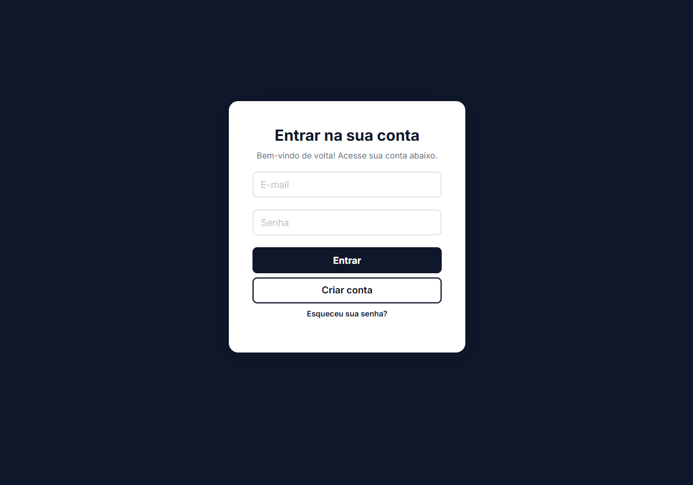
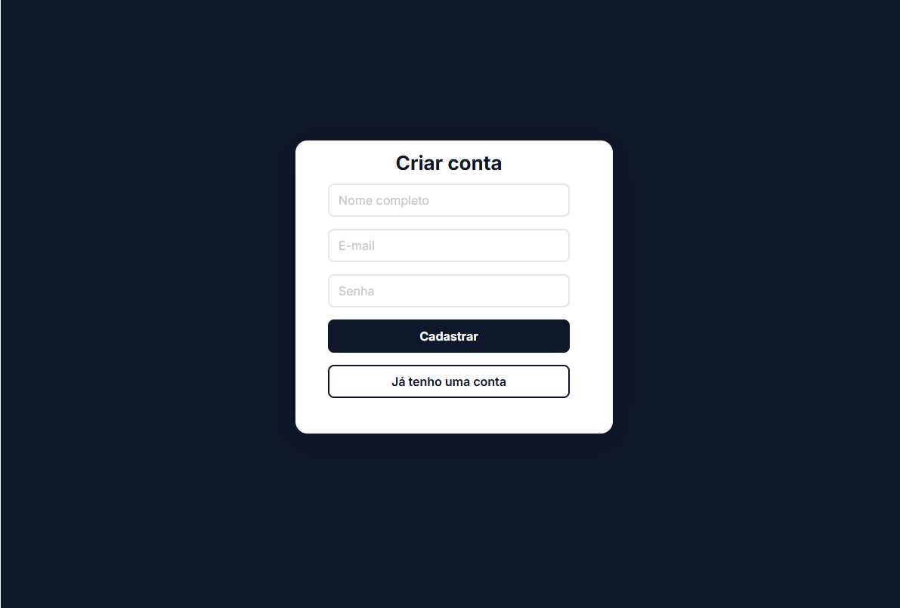
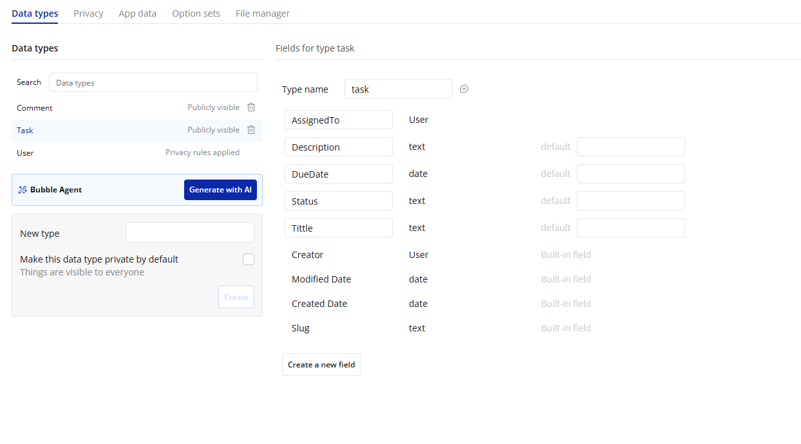
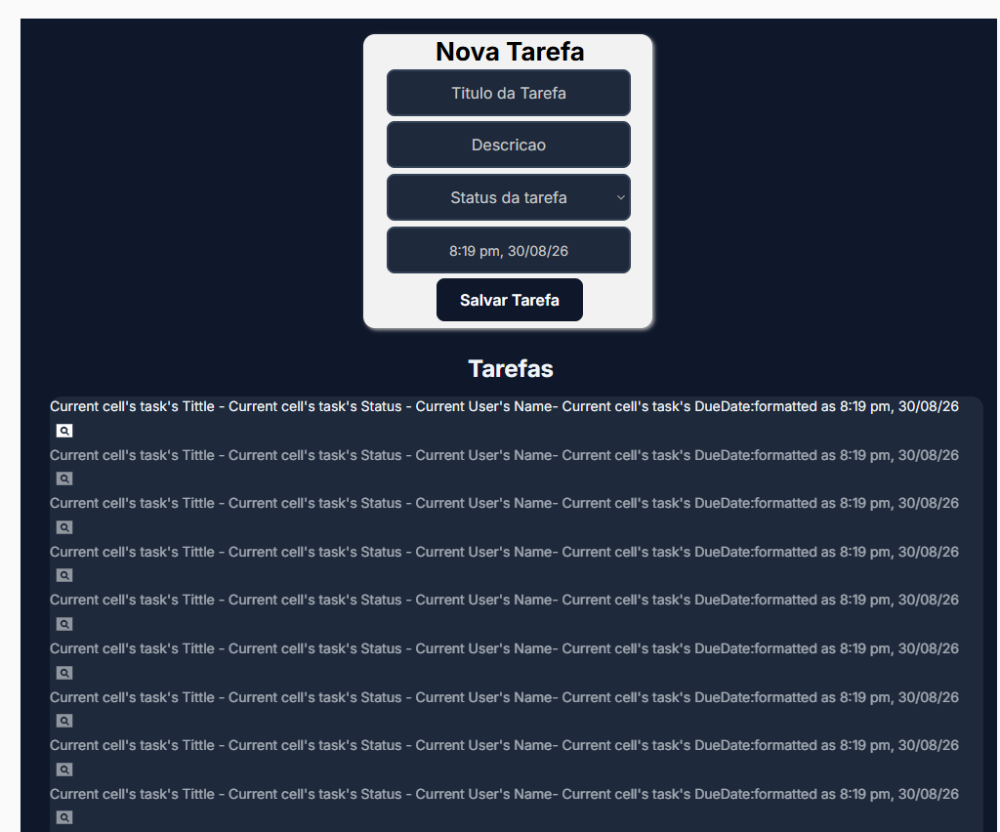
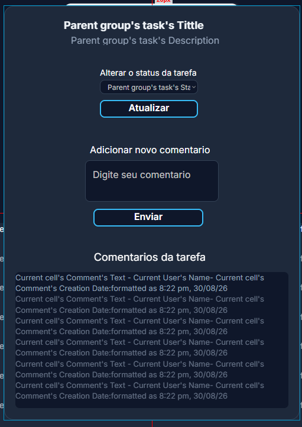
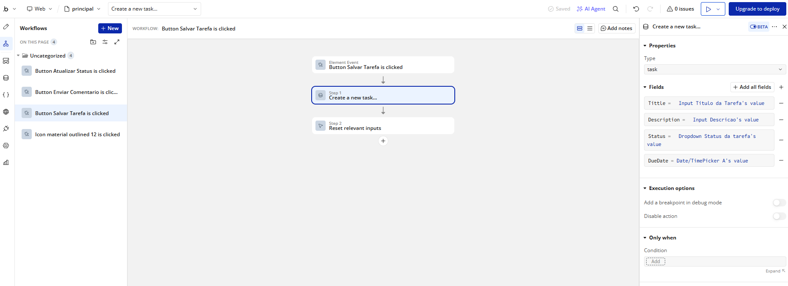

# Taskly.io: gestão de tarefas e colaboração no Bubble

> Projeto acadêmico **no-code full-stack**: aplicação web de gestão de tarefas feita no **Bubble**, com autenticação, recuperação de senha, banco de dados relacional, tarefas com status e comentários por tarefa.

**Disciplina:** Fundamentos de No-Code e Low-Code · **Autor:** Bruno de Campos Farias · **Plataforma:** Bubble

🌐 [Ambiente de teste do app](https://brunofarias240507.bubbleapps.io/version-test): crie uma conta fictícia para testar.

## O que o app faz

| Funcionalidade | Como funciona |
| --- | --- |
| **Cadastro e login** | Criação de conta e login com as ações nativas do Bubble, com senha criptografada |
| **Recuperação de senha** | E-mail com token de redefinição e página própria para cadastrar a nova senha |
| **Criar tarefa** | Título, descrição, status e prazo, com data e hora preenchidas automaticamente |
| **Painel de tarefas** | Lista dinâmica (Repeating Group) com título, status, responsável e data |
| **Detalhes da tarefa** | Popup com os dados da tarefa, troca de status em um clique e comentários |
| **Comentários** | Histórico com autor e data de cada comentário, ligado à tarefa |

<p>
  
  
</p>

## Modelagem de dados

Três tabelas relacionadas:

```
User ──< Task (Creator, AssignedTo)
Task ──< Comment (RelatedTask)
User ──< Comment (Creator)
```

| Tabela | Campos |
| --- | --- |
| **User** | Name, email, password (criptografada pelo Bubble) |
| **Task** | Tittle, Description, Status (To Do, In Progress, Done), DueDate, Creator, AssignedTo |
| **Comment** | Text, RelatedTask, Creator |



## Interface

O painel principal tem o formulário de nova tarefa e a lista de tarefas. Ao clicar numa tarefa, abre um popup com os detalhes, o botão de atualizar status e os comentários.

<p>
  
  
</p>

*Prints do editor do Bubble: os textos em azul são as expressões dinâmicas que o app preenche com os dados reais.*

## Workflows

A lógica roda em workflows disparados por eventos. Exemplo do botão **Salvar Tarefa**: cria a tarefa com os valores do formulário e limpa os campos em seguida.



Outros fluxos do app:

- **Responsável e autor automáticos:** o usuário logado (Current User) é gravado na tarefa e no comentário, sem precisar digitar o nome.
- **Comentário ligado à tarefa:** o comentário é salvo com a tarefa aberta no popup (Parent group's task).
- **Recuperação de senha:** envia o e-mail de redefinição, mostra um aviso, espera 3 segundos e redireciona.
- **Privacidade:** a regra padrão da tabela User foi ajustada para mostrar apenas o **nome** de cada usuário para a equipe, sem expor e-mails.

## No-code: o que ganha e o que perde

| Ganhos | Limitações |
| --- | --- |
| Front-end, back-end e banco num lugar só, feito por uma pessoa | **Vendor lock-in:** o código não pode ser exportado para outro servidor |
| Infraestrutura, SSL, backups e deploy cuidados pelo Bubble | Pouco controle de baixo nível para otimizar desempenho |
| Ajuste de regra no editor visual, publicado na hora | Lógica complexa fica difícil de versionar e revisar como código |

## Próximos passos

1. **Delegar de verdade:** hoje o responsável (AssignedTo) é sempre quem cria a tarefa. Um seletor de usuário no formulário permitiria atribuir a outra pessoa.
2. **Ver só o que é seu:** filtrar o painel por responsável e por status.
3. **Restringir edição:** regra de privacidade para que só o autor ou o responsável alterem a tarefa.
4. **Avisos por e-mail:** notificar o responsável quando receber uma tarefa ou um comentário novo.
